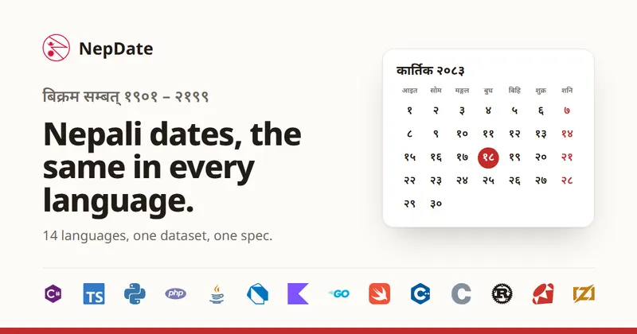
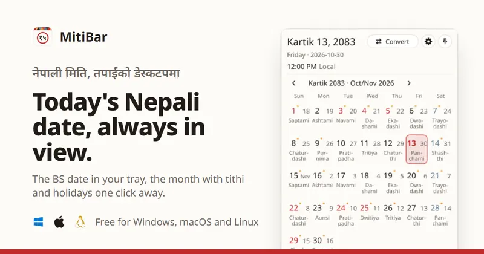
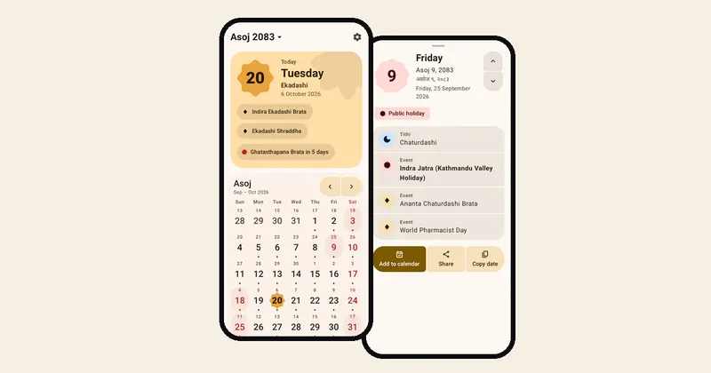
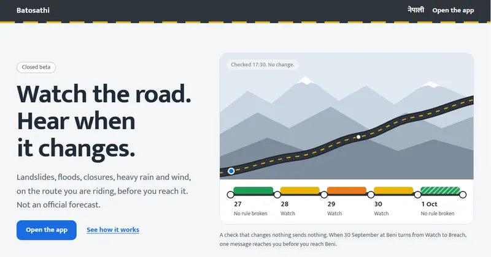
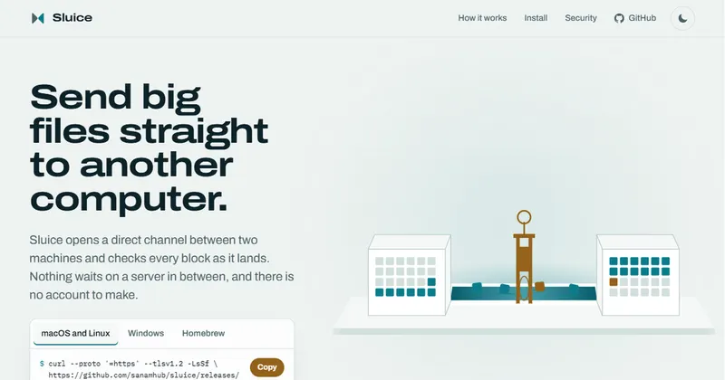
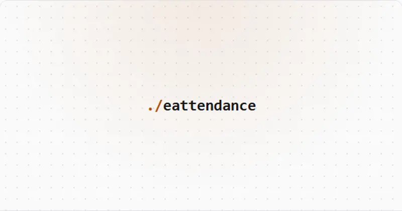

<!-- introduction -->
<h1 align="center">Hi, I'm Sanam Pakuwal 👋</h1>

  <b>Technical Lead · Software Engineer</b> 
  .NET · SQL Server · Distributed Systems · AI 
  Kathmandu, Nepal 🇳🇵

  I lead engineering for an e-commerce platform in Singapore, from Kathmandu. By day that means 
  .NET, SQL Server and search that carry real traffic. The rest of the time I build my own 
  products, most of them for Nepal: its calendar, its roads.

  
  
  
  
  
  

 

<!-- numbers -->
<table align="center">
  <tr>
    <td align="center"><b>7 yrs</b> engineering, DBA and QA</td>
    <td align="center"><b>&lt;100 ms</b> product search, down from 1 to 2 s</td>
    <td align="center"><b>450+</b> institutions served by a FinTech platform I worked on</td>
    <td align="center"><b>38,800+</b> NuGet downloads of NepDate</td>
  </tr>
</table>

 

<!-- products -->
<h3 align="center">Things I make</h3>

<table>
  <tr>
    <td colspan="2">
      
      <h4> <a href="https://nepdate.com">NepDate</a></h4>
      Bikram Sambat, the Nepali calendar, for 14 programming languages. One dataset and one spec, so every language gives the same day for the same date. 13.5 ns per conversion in C#. 
      C# · TypeScript · Python · PHP · Java · Dart · Kotlin · Go · Swift · C++ · C · Rust · Ruby · Zig &nbsp;|&nbsp; <a href="https://github.com/sanamhub/nepdate">source</a>
    </td>
  </tr>
  <tr>
    <td width="50%" valign="top">
      
      <h4> <a href="https://nepdate.com/mitibar/">MitiBar</a></h4>
      The Nepali date on your desktop: a bar above the Windows taskbar, the tray or menu bar everywhere, the month one click away. 
      Rust · Windows, macOS, Linux · <a href="https://github.com/sanamhub/mitibar">source</a>
    </td>
    <td width="50%" valign="top">
      
      <h4> <a href="https://patro.nepdate.com">NepDate Patro</a></h4>
      A Nepali calendar for Android and iPhone with home and lock screen widgets. No ads, no account, no network permission. 
      Kotlin · Swift · apps coming soon, web live · <a href="https://github.com/sanamhub/nepdate-mobile">source</a>
    </td>
  </tr>
  <tr>
    <td width="50%" valign="top">
      
      <h4> <a href="https://batosathi.com">Batosathi</a></h4>
      Road and weather alerts for a trip across Nepal. It watches your route and dates, and messages you when the answer changes. 
      C# · ASP.NET Core · closed beta
    </td>
    <td width="50%" valign="top">
      
      <h4> <a href="https://curioflux.com">Curioflux</a></h4>
      A self-hosted knowledge base. Send a link from your phone; it archives the page, links it to what you saved, and answers coding agents over MCP. 
      C# · SQLite FTS5 · MCP
    </td>
  </tr>
  <tr>
    <td width="50%" valign="top">
      
      <h4> <a href="https://sluicedrop.com">Sluice</a></h4>
      Send big files straight to another computer. Every block checked as it lands, transfers resume, nothing stored in between. 
      Rust · <code>brew install sanamhub/tap/sluice</code> · <a href="https://github.com/sanamhub/sluice">source</a>
    </td>
    <td width="50%" valign="top">
      
      <h4>RsService</h4>
      Service center platform: service requests, customers, RMA, warranty and revenue reports. 
      C# · ASP.NET Core · SQL Server
    </td>
  </tr>
  <tr>
    <td width="50%" valign="top">
      
      <h4>LMS</h4>
      Learning management system with video content protection and S3 storage. 
      C# · ASP.NET Core
    </td>
    <td width="50%" valign="top">
      
      <h4>GymHub</h4>
      Gym management app: members, attendance tracking and admin workflows. 
      C# · .NET MAUI
    </td>
  </tr>
  <tr>
    <td width="50%" valign="top">
      
      <h4>eAttendance</h4>
      Attendance tracking system with per-site licensing. 
      C#
    </td>
    <td width="50%" valign="middle" align="center">
      <a href="https://sanam.me/#projects"><b>All projects on sanam.me</b></a> 
      and every repository on <a href="https://github.com/sanamhub?tab=repositories">GitHub</a>
    </td>
  </tr>
</table>

 

<!-- libraries -->
<h3 align="center">Open source libraries</h3>

| Library | What it does | |
| --- | --- | --- |
| [postgresql-to-mssql](https://github.com/sanamhub/postgresql-to-mssql) | Stream PostgreSQL data into SQL Server on the fly, for migrations without downtime |  |
| [DotNetMapper](https://github.com/sanamhub/DotNetMapper) | The simplest .NET object mapper, at hand-written speed |   |
| [ada-csharp](https://github.com/sanamhub/ada-csharp) | Fast WHATWG-compliant URL parser for .NET, built on Ada |   |
| [mcp-nuget](https://github.com/sanamhub/mcp-nuget) | Model Context Protocol server shipped as a NuGet tool |  |
| [hulaki](https://github.com/sanamhub/hulaki) | One API for chat, push, email and social delivery, with an honest answer per recipient |  |
| [jharicast](https://github.com/sanamhub/jharicast) | Per-route, per-day weather and road rules for Nepal |  |
| [freetiermail](https://github.com/sanamhub/freetiermail) | Route email across provider free tiers, about 900 a day |  |
| [typesafe-dotnet](https://github.com/sanamhub/typesafe-dotnet) | .NET client for the TypeSafe AI System One API |  |
| [passgen](https://github.com/sanamhub/passgen) | Password generator with a public API |  |

 

<!-- about -->
<h3 align="center">At work</h3>

- Technical Lead at **Singapore Ecommerce App Pte. Ltd.**, remote. I own architecture, code review standards and the platform's AI adoption.
- Took the platform from single region to multi-region in production: SQL Server replication to regional read replicas, cross-region cache invalidation, OpenSearch cross-cluster replication.
- Cut product search from 1 to 2 s to under 100 ms, and a second endpoint from 5 to 20 s to under 80 ms, by moving it onto OpenSearch.
- Before that, at Pratham IT System (2019 to 2023): developer on FinAstra, a cooperative core banking platform used by 450+ institutions, and at the same time QA manager and DBA for its SQL Server and PostgreSQL estate.
- **Stripe Certified Professional Developer** (2023) · **Google AI Professional Certificate** (2026)

 

<!-- stack -->
<h3 align="center">Tools I reach for</h3>

   
  

Also SQL Server, OpenSearch, Garnet, OpenTelemetry, Playwright, and RAG, MCP and agents on systems already in production.

 

<!-- writing -->
<h3 align="center">Writing</h3>

- [Rate limiting in ASP.NET Core](https://sanam.me/blog/rate-limiting-aspnetcore/)
- [Cutting search latency from seconds to under 100ms](https://sanam.me/blog/search-latency-opensearch/)
- [Taking a single-region app to multi-region with SQL Server](https://sanam.me/blog/multi-region-sql-server/)

<a href="https://sanam.me/blog/">All posts</a> · <a href="https://sanam.me/rss.xml">RSS</a>

 

<!-- cat -->

  

<!-- footer -->

  <samp>
    ════ ⋆★⋆ ════
     
    धन्यवाद · thanks for stopping by
  </samp>
   
  <a href="https://sanam.me">sanam.me</a>

