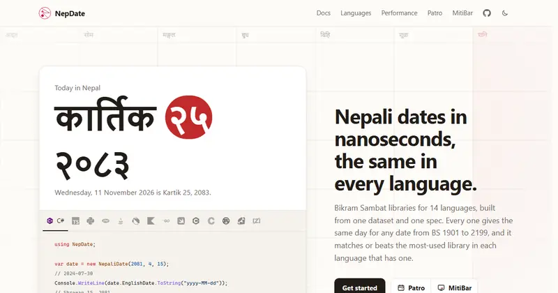
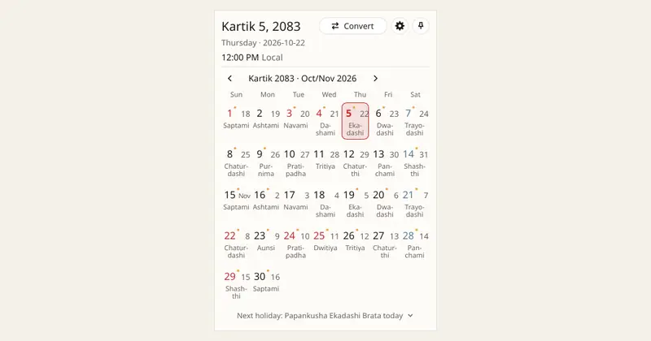
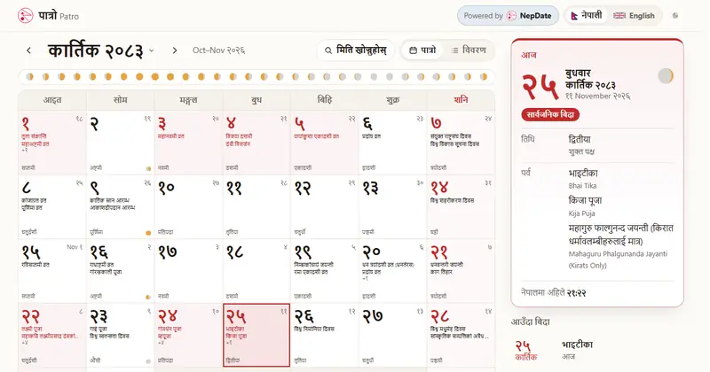
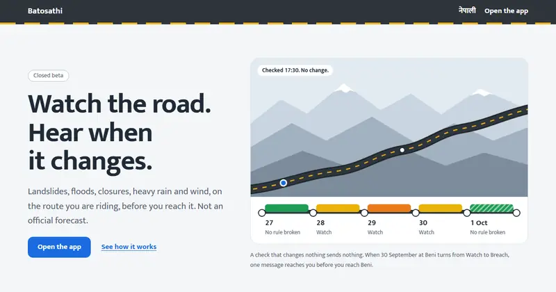
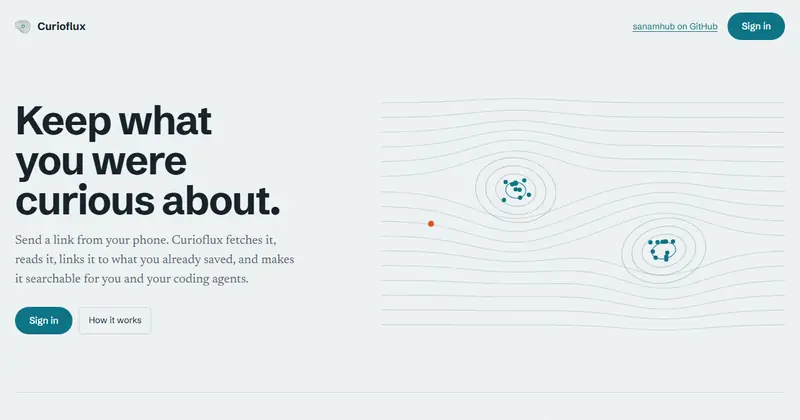
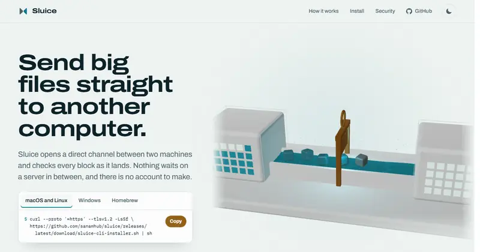
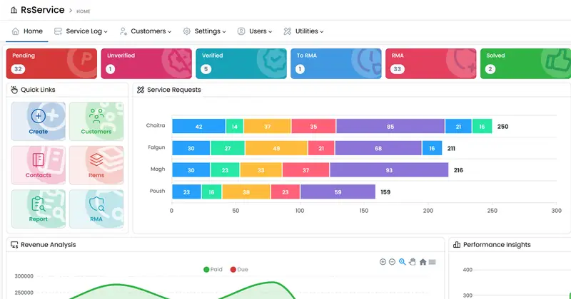

<!-- header: drawn by scripts/header.mjs -->

  <a href="https://sanam.me">
    <picture>
      <source media="(prefers-color-scheme: dark)" srcset="assets/header-dark.svg" />
      
    </picture>
  </a>

  I design distributed systems, make databases fast, and lead the engineers who run them.
  The rest of the time I build my own products: a Nepali calendar in 14 programming languages,
  desktop and mobile apps, and tools I wanted to exist.

  <a href="https://sanam.me"><b>sanam.me</b></a> ·
  <a href="https://sanam.me/sanam-cv.pdf">CV</a> ·
  <a href="mailto:sanampakuwal27@gmail.com">Email</a> ·
  <a href="https://www.linkedin.com/in/sanampakuwal">LinkedIn</a> ·
  <a href="https://x.com/sanampakuwal">X</a> ·
  <a href="https://bsky.app/profile/sanam.me">Bluesky</a> ·
  <a href="https://www.instagram.com/sanampakuwal">Instagram</a> ·
  <a href="https://sanampakuwal.t.me">Telegram</a>

 

<!-- numbers -->
<table align="center">
  <tr>
    <td align="center"><b>7 yrs</b> building and running production systems</td>
    <td align="center"><b>13</b> languages I have written NepDate in</td>
    <td align="center"><b>60</b> open source repositories</td>
    <td align="center"><b>6</b> products of my own, shipped or in beta</td>
  </tr>
</table>

 

<!-- contributions: redrawn daily by .github/workflows/refresh.yml -->

  <a href="https://github.com/sanamhub">
    <picture>
      <source media="(prefers-color-scheme: dark)" srcset="assets/contributions-dark.svg" />
      
    </picture>
  </a>

 

<!-- products -->
<h3 align="center">Things I make</h3>

<table>
  <tr>
    <td colspan="2">
      <a href="https://nepdate.com"><picture><source media="(prefers-color-scheme: dark)" srcset="assets/projects/nepdate-dark.webp" /></picture></a>
      <h4> <a href="https://nepdate.com">NepDate</a></h4>
      Bikram Sambat, the Nepali calendar, for 14 programming languages. One dataset and one spec, so every language gives the same day for the same date. I wrote the ports for 13 of them and co-maintain the C# original by Raju Prasai. 
      C# · TypeScript · Python · PHP · Java · Dart · Kotlin · Go · Swift · C++ · C · Rust · Ruby · Zig &nbsp;|&nbsp; <a href="https://github.com/sanamhub/nepdate">source</a>
    </td>
  </tr>
  <tr>
    <td width="50%" valign="top">
      <a href="https://nepdate.com/mitibar/"><picture><source media="(prefers-color-scheme: dark)" srcset="assets/projects/mitibar-dark.webp" /></picture></a>
      <h4> <a href="https://nepdate.com/mitibar/">MitiBar</a></h4>
      The Nepali date on your desktop: a bar above the Windows taskbar, the tray or menu bar everywhere, the month one click away. 
      Rust · Windows, macOS, Linux · <a href="https://github.com/sanamhub/mitibar">source</a>
    </td>
    <td width="50%" valign="top">
      <a href="https://patro.nepdate.com"><picture><source media="(prefers-color-scheme: dark)" srcset="assets/projects/patro-dark.webp" /></picture></a>
      <h4> <a href="https://patro.nepdate.com">NepDate Patro</a></h4>
      A Nepali calendar for Android and iPhone with home and lock screen widgets. No ads, no account, no network permission. 
      Kotlin · Swift · web live, Android in closed beta, iPhone in progress · <a href="https://github.com/sanamhub/nepdate-mobile">source</a>
    </td>
  </tr>
  <tr>
    <td width="50%" valign="top">
      <a href="https://batosathi.com"><picture><source media="(prefers-color-scheme: dark)" srcset="assets/projects/batosathi-dark.webp" /></picture></a>
      <h4> <a href="https://batosathi.com">Batosathi</a></h4>
      Road and weather alerts for a trip across Nepal. It watches your route and dates, and messages you when the answer changes. 
      C# · ASP.NET Core · PostgreSQL · closed beta
    </td>
    <td width="50%" valign="top">
      <a href="https://curioflux.com"><picture><source media="(prefers-color-scheme: dark)" srcset="assets/projects/curioflux-dark.webp" /></picture></a>
      <h4> <a href="https://curioflux.com">Curioflux</a></h4>
      A self-hosted knowledge base. Send a link from your phone; it archives the page, links it to what you saved, and answers coding agents over MCP. 
      C# · SQLite FTS5 · React · MCP · in daily use
    </td>
  </tr>
  <tr>
    <td width="50%" valign="top">
      <a href="https://sluicedrop.com"><picture><source media="(prefers-color-scheme: dark)" srcset="assets/projects/sluice-dark.webp" /></picture></a>
      <h4> <a href="https://sluicedrop.com">Sluice</a></h4>
      Send big files straight to another computer over QUIC. Every block checked as it lands, transfers resume, a growing file can be read live, and nothing is stored in between. 
      Rust · v0.1.0 · <code>brew install sanamhub/tap/sluice</code> · <a href="https://github.com/sanamhub/sluice">source</a>
    </td>
    <td width="50%" valign="top">
      <picture><source media="(prefers-color-scheme: dark)" srcset="assets/projects/rsservice-dark.webp" /></picture>
      <h4>RsService</h4>
      Service center platform: service requests, customers, RMA, warranty and revenue reports. 
      C# · ASP.NET Core · SQL Server
    </td>
  </tr>
  <tr>
    <td width="50%" valign="top">
      <picture><source media="(prefers-color-scheme: dark)" srcset="assets/projects/lms-dark.webp" /></picture>
      <h4>LMS</h4>
      Learning management system with video content protection and S3 storage. 
      C# · ASP.NET Core · PostgreSQL · Redis · S3 · Docker
    </td>
    <td width="50%" valign="middle" align="center">
      <a href="https://sanam.me/#projects"><b>All projects on sanam.me</b></a> 
      and every repository on <a href="https://github.com/sanamhub?tab=repositories">GitHub</a>
    </td>
  </tr>
</table>

Client work also includes GymHub, a gym management app on .NET MAUI, and eAttendance, attendance tracking with per-site licensing.

 

<!-- libraries -->
<h3 align="center">Libraries and tools</h3>

| Library | What it does | |
| --- | --- | --- |
| [postgresql-to-mssql](https://github.com/sanamhub/postgresql-to-mssql) | Stream PostgreSQL data into SQL Server on the fly, for migrations without downtime |  |
| [DotNetMapper](https://github.com/sanamhub/DotNetMapper) | The simplest .NET object mapper, at hand-written speed |   |
| [ada-csharp](https://github.com/sanamhub/ada-csharp) | Fast WHATWG-compliant URL parser for .NET, built on Ada |   |
| [mcp-nuget](https://github.com/sanamhub/mcp-nuget) | A sample Model Context Protocol server published as a NuGet tool |  |
| [hulaki](https://github.com/sanamhub/hulaki) | One API for chat, push, email and social delivery, with an honest answer per recipient |  |
| [jharicast](https://github.com/sanamhub/jharicast) | Per-route, per-day weather and road rules for Nepal |  |
| [freetiermail](https://github.com/sanamhub/freetiermail) | Route email across provider free tiers, about 900 a day |  |
| [typesafe-dotnet](https://github.com/sanamhub/typesafe-dotnet) | .NET client for the TypeSafe AI System One API |  |
| [passgen](https://github.com/sanamhub/passgen) | Password generator with a public API |  |

 

<!-- about -->
<h3 align="center">At work</h3>

- Technical Lead at **Singapore Ecommerce App Pte. Ltd.** I own architecture, code review standards and the platform's AI adoption.
- Took the platform from single region to multi-region in production: SQL Server replication to regional read replicas, cross-region cache invalidation, OpenSearch cross-cluster replication.
- Cut product search from 1 to 2 s to under 100 ms, and a second endpoint from 5 to 20 s to under 80 ms, by moving it onto OpenSearch.
- Before that, at Pratham IT System (2019 to 2023): developer on FinAstra, a core banking platform for cooperatives, and at the same time QA manager and DBA for its SQL Server and PostgreSQL estate.
- **Stripe Certified Professional Developer** (2023) · **Google AI Professional Certificate** (2026)

 

<!-- stack -->
<h3 align="center">Tools I reach for</h3>

  <picture><source media="(prefers-color-scheme: dark)" srcset="https://skillicons.dev/icons?i=cs,dotnet,postgres,redis,rabbitmq,elasticsearch,grafana,docker,linux,azure&perline=10&theme=dark" /></picture> 
  <picture><source media="(prefers-color-scheme: dark)" srcset="https://skillicons.dev/icons?i=ts,react,nextjs,tailwind,rust,kotlin,swift,git,githubactions,cloudflare&perline=10&theme=dark" /></picture>

Also SQL Server, OpenSearch, Garnet, OpenTelemetry, Playwright, and RAG, MCP and agents on systems already in production.

 

<!-- writing -->
<h3 align="center">Writing</h3>

<!-- posts:start -->
- [Rate limiting in ASP.NET Core](https://sanam.me/blog/rate-limiting-aspnetcore/) Oct 9, 2026
- [Cutting search latency from seconds to under 100ms](https://sanam.me/blog/search-latency-opensearch/) Sep 20, 2026
- [Taking a single-region app to multi-region with SQL Server](https://sanam.me/blog/multi-region-sql-server/) Aug 15, 2026
<!-- posts:end -->

<a href="https://sanam.me/blog/">All posts</a> · <a href="https://sanam.me/rss.xml">RSS</a>

 

<!-- footer -->

  Made in Nepal, on the road as often as at a desk. धन्यवाद for reading this far. 
  <a href="https://sanam.me">sanam.me</a>

