<!-- header: drawn by scripts/header.mjs -->

  <a href="https://sanam.me">
    <picture>
      <source media="(prefers-color-scheme: dark)" srcset="assets/header-dark.svg" />
      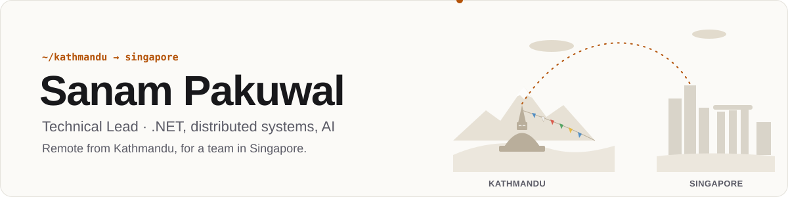
    </picture>
  </a>

I design distributed systems, make databases fast, and lead the engineers who run them. Away from work I build my own products: a Nepali calendar in 14 programming languages, desktop and mobile apps, and tools I wanted to exist.

  <a href="https://sanam.me"><b>sanam.me</b></a> ·
  <a href="https://sanam.me/sanam-cv.pdf">CV</a> ·
  <a href="mailto:sanampakuwal27@gmail.com">Email</a> ·
  <a href="https://www.linkedin.com/in/sanampakuwal">LinkedIn</a> ·
  <a href="https://x.com/sanampakuwal">X</a> ·
  <a href="https://bsky.app/profile/sanam.me">Bluesky</a> ·
  <a href="https://www.instagram.com/sanampakuwal">Instagram</a> ·
  <a href="https://sanampakuwal.t.me">Telegram</a>

<!-- numbers: drawn by scripts/cards.mjs -->

<picture><source media="(prefers-color-scheme: dark)" srcset="assets/stats-dark.svg" />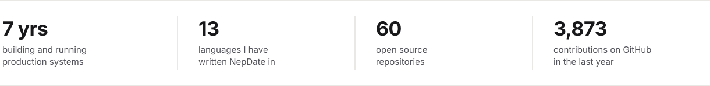</picture>

### Now

- **Building:** [Sluice](https://sluicedrop.com), a Rust tool that sends big files straight from one computer to another. 0.1.0 is out; the work now is the road to 1.0.
- **Shipping:** NepDate Patro for Android, in closed beta, with the iPhone app next. MitiBar 1.1.0 went out on 10 November 2026.
- **At work:** technical direction for a multi-region e-commerce platform, and how it adopts AI.
- **Using daily:** [Curioflux](https://curioflux.com), my self-hosted knowledge base, to keep what I read and hand it to coding agents over MCP.

<!-- contributions: redrawn daily by .github/workflows/refresh.yml -->

  <a href="https://github.com/sanamhub">
    <picture>
      <source media="(prefers-color-scheme: dark)" srcset="assets/contributions-dark.svg" />
      
    </picture>
  </a>

### Projects

What I build in my own time. Most of it started as something I needed, and a lot of it is for Nepal.

<!-- cards: drawn by scripts/cards.mjs -->

<a href="https://nepdate.com"><picture><source media="(prefers-color-scheme: dark)" srcset="assets/cards/nepdate-dark.svg" />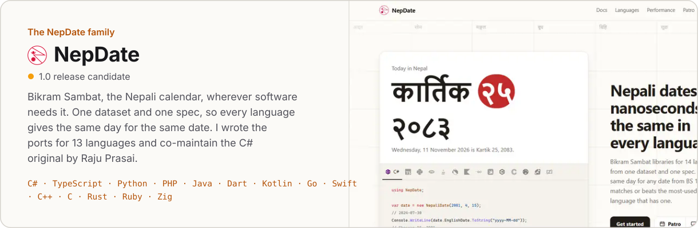</picture></a>

  <a href="https://patro.nepdate.com"><picture><source media="(prefers-color-scheme: dark)" srcset="assets/cards/patro-dark.svg" />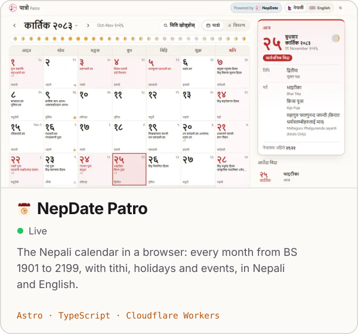</picture></a>
  <a href="https://nepdate.com/mitibar/"><picture><source media="(prefers-color-scheme: dark)" srcset="assets/cards/mitibar-dark.svg" />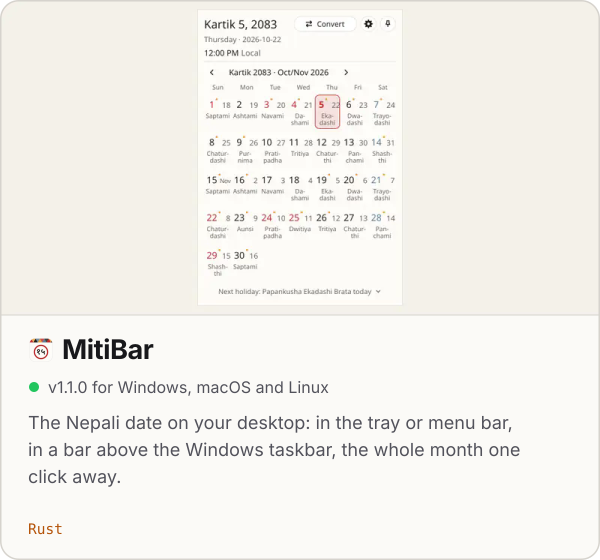</picture></a>

  <a href="https://github.com/sanamhub/nepdate-mobile"><picture><source media="(prefers-color-scheme: dark)" srcset="assets/cards/mobile-dark.svg" />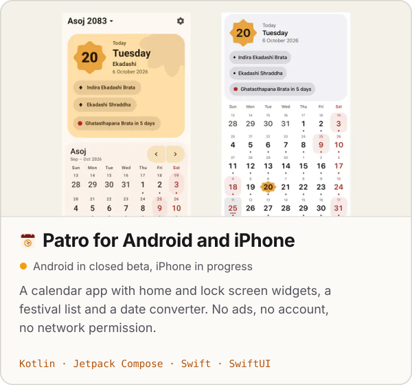</picture></a>
  <a href="https://sluicedrop.com"><picture><source media="(prefers-color-scheme: dark)" srcset="assets/cards/sluice-dark.svg" />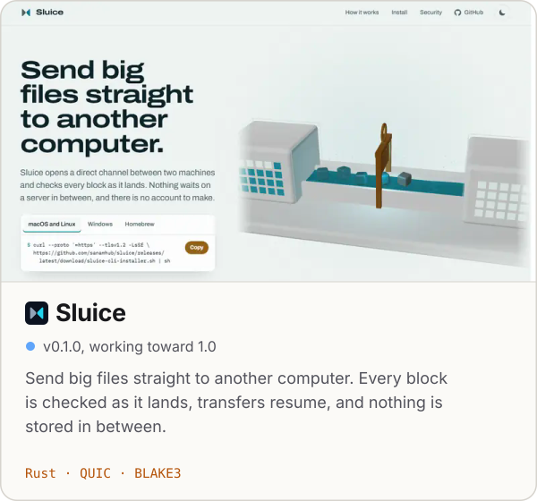</picture></a>

  <a href="https://curioflux.com"><picture><source media="(prefers-color-scheme: dark)" srcset="assets/cards/curioflux-dark.svg" />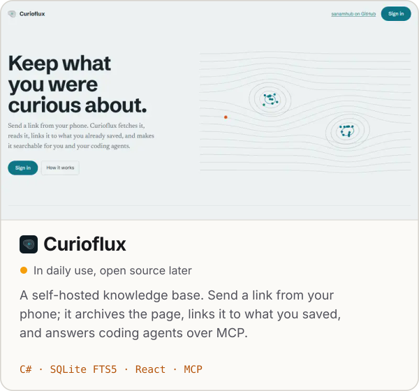</picture></a>
  <a href="https://batosathi.com"><picture><source media="(prefers-color-scheme: dark)" srcset="assets/cards/batosathi-dark.svg" />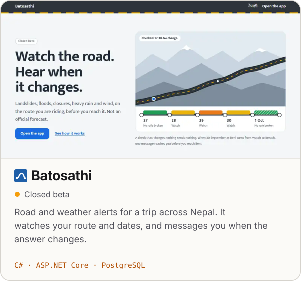</picture></a>

Source: [nepdate](https://github.com/sanamhub/nepdate) · [mitibar](https://github.com/sanamhub/mitibar) · [nepdate-mobile](https://github.com/sanamhub/nepdate-mobile) · [sluice](https://github.com/sanamhub/sluice) (`brew install sanamhub/tap/sluice`)

#### Client work

  <picture><source media="(prefers-color-scheme: dark)" srcset="assets/cards/rsservice-dark.svg" />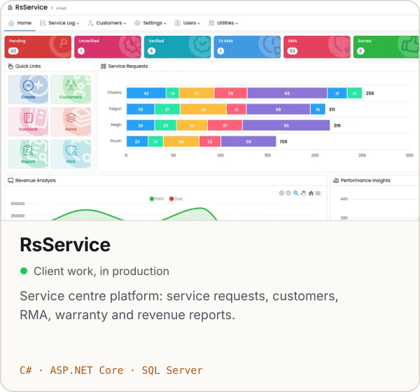</picture>
  <picture><source media="(prefers-color-scheme: dark)" srcset="assets/cards/gymhub-dark.svg" />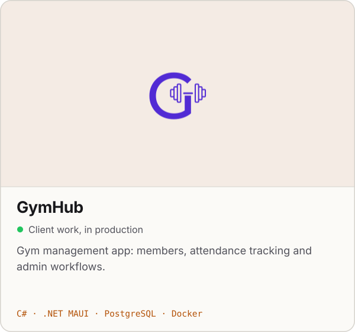</picture>

Also an LMS with protected video, and eAttendance, attendance tracking with per-site licensing. Experience, credentials and the rest are on [sanam.me](https://sanam.me).

### Libraries and tools

| Library | What it does | |
| --- | --- | --- |
| [postgresql-to-mssql](https://github.com/sanamhub/postgresql-to-mssql) | Stream PostgreSQL data into SQL Server on the fly, for migrations without downtime |  |
| [DotNetMapper](https://github.com/sanamhub/DotNetMapper) | The simplest .NET object mapper, at hand-written speed |   |
| [ada-csharp](https://github.com/sanamhub/ada-csharp) | Fast WHATWG-compliant URL parser for .NET, built on Ada |   |
| [mcp-nuget](https://github.com/sanamhub/mcp-nuget) | A sample Model Context Protocol server published as a NuGet tool |  |
| [hulaki](https://github.com/sanamhub/hulaki) | One API for chat, push, email and social delivery, with an honest answer per recipient |  |
| [jharicast](https://github.com/sanamhub/jharicast) | Per-route, per-day weather and road rules for Nepal |  |
| [freetiermail](https://github.com/sanamhub/freetiermail) | Route email across provider free tiers, about 900 a day |  |
| [typesafe-dotnet](https://github.com/sanamhub/typesafe-dotnet) | .NET client for the TypeSafe AI System One API |  |
| [passgen](https://github.com/sanamhub/passgen) | Password generator with a public API |  |

### Writing

<!-- posts:start -->
- [Rate limiting in ASP.NET Core](https://sanam.me/blog/rate-limiting-aspnetcore/) Oct 9, 2026
- [Cutting search latency from seconds to under 100ms](https://sanam.me/blog/search-latency-opensearch/) Sep 20, 2026
- [Taking a single-region app to multi-region with SQL Server](https://sanam.me/blog/multi-region-sql-server/) Aug 15, 2026
<!-- posts:end -->

[All posts](https://sanam.me/blog/) · [RSS](https://sanam.me/rss.xml)

### What I work with

<!-- stack: drawn by scripts/cards.mjs -->

<picture><source media="(prefers-color-scheme: dark)" srcset="assets/stack-dark.svg" />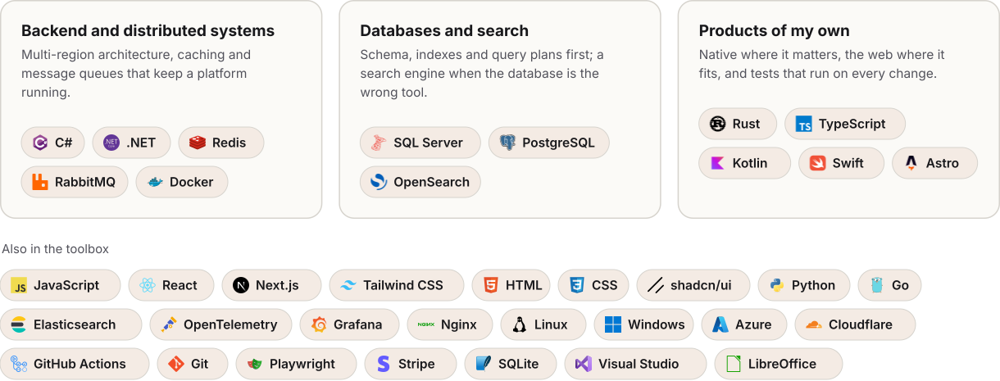</picture>

<!-- cat -->

  

<!-- footer -->

  <samp>
    ════ ⋆★⋆ ════
     
    धन्यवाद · thanks for stopping by
  </samp>
   
  <a href="https://sanam.me">sanam.me</a>

